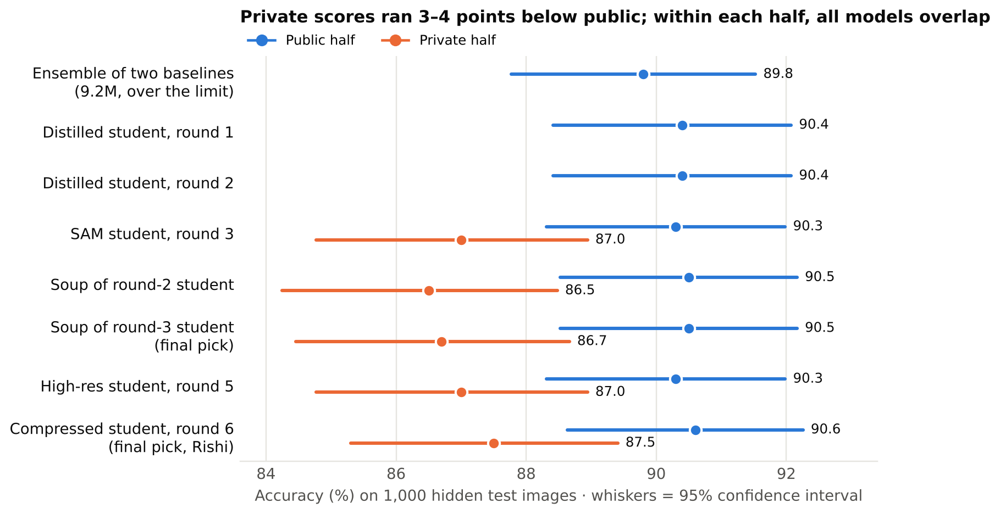
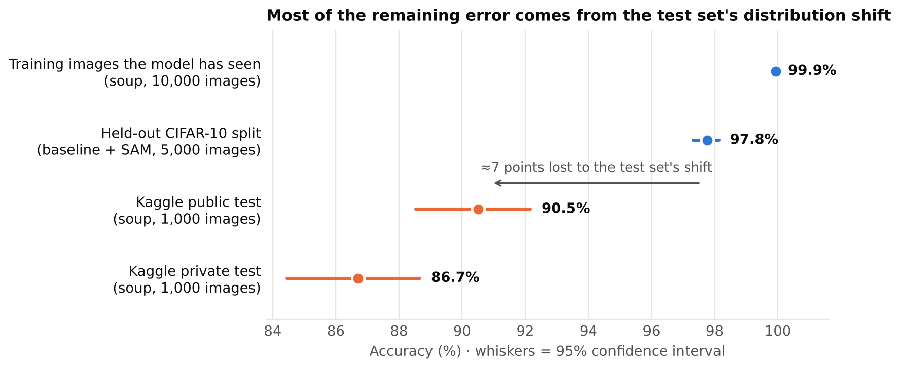

# CIFAR-10 ResNet under 5M parameters

**Team Transformers (Rishi Ajith and Kalp Patel)** · NYU Tandon Deep Learning, Fall 2026, Project 1

Our entry for the course's Kaggle challenge: the highest accuracy on 2,000 hidden CIFAR-10 test images with a ResNet
trained from scratch and at most 5 million trainable parameters.

Our two final submissions, both 4,918,602 trainable parameters:

| Final pick | Public | Private | In this repo |
|---|---|---|---|
| Compressed student, round 6 (Rishi Ajith) | 0.906 | 0.875 | [Submitted CSV](results/tm_compress_seed51_ema_final_flip.csv) · [EMA checkpoint](checkpoints/tm_compress_seed51_ema_final_weights.pt) |
| **Soup of the round-3 SAM student, round 4 (Kalp Patel)** | **0.905** | **0.867** | [Submitted CSV](results/submission_soup_kd3_tta10.csv) · [Soup checkpoint](checkpoints/soup_kd3_model_final.pt) |

Everything is trained from scratch on the competition's 50,000 training images: no pretrained weights and no
external data. The round-6 model also uses the 2,000 unlabelled test images (see [Rules](#compliance-with-the-competition-rules)).



## Reproduce the two submissions

Use Python 3.11 and extract the competition files into `data/`. The compressed workflow reads `test.csv`, `test_images/` and `sample_submission.csv`. The soup workflow reads the same test CSV and PNGs.

```bash
python -m pip install -r requirements.txt
python predict_compressed.py --data data --output compressed.csv
python predict.py --checkpoint checkpoints/soup_kd3_model_final.pt --data data --views 10 --out soup.csv
```

The compressed student uses CPU FP32 and averages softmax probabilities for the original and horizontally flipped image. Its script verifies the generated bytes against the archived submission. The KD3 soup averages ten views across flips and five shifts. Its reference predictions are in [the soup CSV](results/submission_soup_kd3_tta10.csv). Both predictors return the competition class indices in test ID order. [Executed results notebook](results.ipynb) · [Artifact hashes and scores](results/submissions.json)

## Results

| Model | Round | Trainable params | Held-out CIFAR-10 | Public | Private |
|---|---|---|---|---|---|
| Baseline | 0 | 4,623,178 | 97.64% | – | – |
| Baseline + SAM | ablation | 4,623,178 | 97.76% | – | – |
| Ensemble of two baselines | 0 | 9,246,356 (over the limit) | – | 0.898 | – |
| Distilled student | 1 | 4,623,178 | – | 0.904 | – |
| Distilled student, bigger teachers | 2 | 4,918,602 | – | 0.904 | – |
| Distilled student + SAM | 3 | 4,918,602 | – | 0.903 | 0.870 |
| Soup of the round-2 student | 4 | 4,918,602 | – | 0.905 | 0.865 |
| **Soup of the round-3 student (final pick)** | **4** | **4,918,602** | – | **0.905** | **0.867** |
| High-resolution student | 5 | 4,918,602 | – | 0.903 | 0.870 |
| Compressed student (final pick) | 6 | 4,918,602 | – | 0.906 | 0.875 |

Held-out accuracy is on 5,000 training images kept out of training (flip test-time augmentation). Kaggle evaluated 1,000 images per half. The round-6 submission uses two inference views and the KD3 soup uses ten. On each half, one image is worth 0.1 points and the 95%
confidence interval is about ±1.9 points; a dash means a score we did not record. Models from round 1 on were trained on all 50,000 images, so they have no held-out score. Every run, including
the teachers, is listed in [`results/models.csv`](results/models.csv). The team finished 24th on the public
leaderboard and 26th on the private one.

## How the round-3 soup was built

1. **Teachers** (`scripts/1_teachers.sh`): four larger ResNets trained from scratch on the same 50,000 images: two
   at 10.4M parameters (widths 96/192/384) and two at 18.5M (widths 128/256/512). They are never submitted, so the
   5M limit does not apply to them.
2. **Distilled student** (`scripts/2_distill.sh`): the 4.92M student (widths 64/128/256, blocks 3-5-3) is trained for
   500 epochs to match the teachers' averaged predictions at temperature 4 (90% of the loss) and the true labels
   (10%). Teachers see exactly the same augmented image as the student.
3. **SAM student** (`scripts/3_sam_student.sh`): the same recipe with Sharpness-Aware Minimization (rho 0.05) and the
   round-2 student as a fifth teacher, for 500 epochs.
4. **Model soup** (`scripts/4_model_soup.sh`): four copies of the SAM student are fine-tuned for 30 epochs each (peak
   learning rates 0.02–0.05, seeds 101–104, SAM), then their weights and BatchNorm statistics are averaged
   (`soup.py`). The result is a single network with the same parameter count.

Shared training recipe (`train.py`): random crop and flip, TrivialAugment-style operations and random erasing on the
GPU, CutMix except in the last epochs, label smoothing 0.1, SGD with Nesterov momentum (learning rate 0.2, batch 256,
5-epoch warm-up then cosine decay), weight decay 5e-4 (not on BatchNorm or bias), mixed precision, and an
exponential moving average of the weights (decay 0.999), which is what gets saved.

### Network

| Part | Output size | Channels | Blocks |
|---|---|---|---|
| Stem: 3x3 conv, BN, ReLU | 32x32 | 64 | – |
| Stage 1 | 32x32 | 64 | 3 |
| Stage 2 (stride 2, 1x1 conv shortcut) | 16x16 | 128 | 5 |
| Stage 3 (stride 2, 1x1 conv shortcut) | 8x8 | 256 | 3 |
| Global average pool, linear layer | 1x1 | 10 | – |

Each block is `y = ReLU(F(x) + S(x))` with `F` = conv3x3-BN-ReLU-conv3x3-BN and `S` the identity or a 1x1
conv-BN projection. The definition is in [`model.py`](model.py).

## Round 6: ensemble compression on the unlabelled test images (Rishi Ajith)

Our other final pick starts from the soup of the round-2 student and fine-tunes it for 40 epochs so that it gives the
same answers as a five-model ensemble (the four teachers and the soup) on the 2,000 test images. Each training step
combines 256 labelled training images, distilled from the four teachers as above, with 128 test images whose fixed
target is the ensemble's averaged prediction. No test labels exist in the competition data and none were used. The
student's agreement with the ensemble rose from 97.15% to 99.70%, and it scored 0.906 public / 0.875 private, the
best of our submissions on both halves. [Original trainer](training/outputs/replica_kd/replica_train.py) · [Recorded configuration](training/config.json) · [Epoch history](results/history.json)

The fixed targets use temperature 4 and ten views per teacher. Seed 51 uses EMA decay 0.999, Nesterov SGD, peak learning rate 0.02, one warmup epoch and cosine decay. The bundled KD2 soup supplies the starting weights and joins the four larger teachers for compression. The selected KD3 soup is a separate final model.

To repeat round 6, also provide `train_labels.csv` and `train_images/` in the competition folder. The first command verifies the 50,000 labeled images, 2,000 test images, five source checkpoints and starting state on CPU. The second runs the training stage on a BF16-capable CUDA GPU.

```bash
python train_compression.py --data data --check-inputs
python train_compression.py --data data --out runs/compression
python predict_compressed.py --data data --weights runs/compression/ema_weights.pt --output runs/retrained.csv
```

## Retrain rounds 0–5 from scratch

```bash
bash scripts/0_baselines.sh          # round 0 baselines (also round-1 teachers)
bash scripts/1_teachers.sh           # four teachers
bash scripts/2_distill.sh            # round 1 and round 2 students
bash scripts/3_sam_student.sh        # round 3 SAM student
bash scripts/4_model_soup.sh kd3     # the selected soup -> runs/soup_kd3/  (omit "kd3" to also build soup_kd2)
bash scripts/5_other_experiments.sh  # SAM ablation and the round-5 high-res student (optional)
```

Set `DATA=` and `OUT=` to change the data and output folders (defaults `data/` and `runs/`). Every run writes its
log, curves, `model_final.pt` and `submission.csv` (plus `submission_tta10.csv` with `--tta10`) to its own folder,
and resumes from its last checkpoint if restarted. On one A100, a 500-epoch distillation run took about 1.6 hours
(about 2.4 hours with SAM), each 30-epoch soup copy about 9 minutes, and the 300-epoch high-resolution run about
75 minutes. Exact numbers vary from run to run, since GPU training is not bit-for-bit deterministic.

## Repository layout

```
model.py, predict.py                 KD3 soup architecture, loading and prediction
student.py, predict_compressed.py    compressed model and verified two-view prediction
train.py, soup.py, scripts/          train and average models from rounds 0–5
train_compression.py, training/      run round 6 with its original trainer and source weights
checkpoints/                        both final inference checkpoints
results/, results.ipynb             both CSVs, scores, hashes, epoch history and notebook
docs/                               team report, editable source and figures
```

## Report

The project report (ideas, lessons learned and results) is in [`docs/report.pdf`](docs/report.pdf). Figures from our
analysis are in [`docs/figures/`](docs/figures).



The biggest lesson: our models reached 97.6–97.8% on held-out CIFAR-10 images but about 90% on the public half and
86–88% on the private half of the hidden test set. That shift dwarfed every gain after distillation, and the
1,000-image leaderboard halves were too noisy to separate most of the later ideas.

## Compliance with the competition rules

- Both final submissions have 4,918,602 trainable parameters, under the 5,000,000 limit (`python model.py` prints
  the counts).
- All training originates from scratch-trained competition models. Soup fine-tuning and round-6 compression initialize from earlier team checkpoints.
- No external data: only the competition's own images are used. Rounds 0–5, including the round-3 soup, train on
  the 50,000 labelled training images and use the test images only for prediction.
- Round 6 additionally fine-tunes on the 2,000 competition test images without labels (none exist in the data); this
  is disclosed in the report.
- Teachers exceed 5M parameters, which the project brief allows for distillation; they are never submitted.

## References

He et al., *Deep residual learning for image recognition*, CVPR 2016 · Hinton et al., *Distilling the knowledge in a
neural network*, 2015 · Beyer et al., *Knowledge distillation: a good teacher is patient and consistent*, CVPR 2022 ·
Foret et al., *Sharpness-Aware Minimization*, ICLR 2021 · Wortsman et al., *Model soups*, ICML 2022 · Müller & Hutter,
*TrivialAugment*, ICCV 2021 · Yun et al., *CutMix*, ICCV 2019 · Zhong et al., *Random erasing*, AAAI 2020 ·
Recht et al., *Do CIFAR-10 classifiers generalize to CIFAR-10?*, 2018 · Miller et al., *Accuracy on the line*, ICML 2021.
