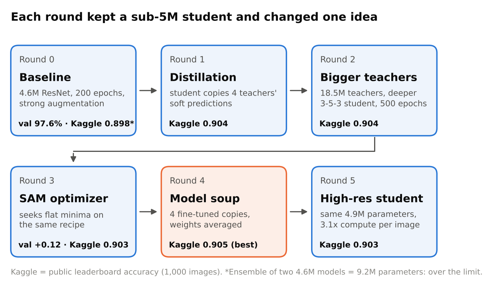

# CIFAR-10 ResNet under 5M parameters

Our entry for the NYU Tandon Deep Learning (Fall 2026) Kaggle challenge: the highest accuracy on 2,000 hidden
CIFAR-10 test images with a ResNet trained from scratch and at most 5 million trainable parameters.

**Selected final model:** a model soup of a distilled 3-stage ResNet, **4,918,602 trainable parameters**,
**0.905 public leaderboard accuracy**. Everything is trained from scratch on the competition's 50,000 training
images; no pretrained weights and no external data.

Team: Kalp Patel (kpp10037), <add teammates>



## Quick start: reproduce our submission

```bash
pip install -r requirements.txt
# put the Kaggle competition files in data/ (test.csv and test_images/ are all predict.py needs)
python predict.py --checkpoint checkpoints/soup_kd2_model_final.pt --data data --out submission.csv
```

`predict.py` loads the checkpoint, applies the same normalization and 10-view test-time augmentation (horizontal
flip x centre and ±2-pixel shifts) used for our Kaggle submission, and writes `id,label` for the 2,000 test images.
It takes a few seconds on a GPU and 2–3 minutes on a CPU. Its output matches our submitted file
(`results/submission_soup_kd2_tta10.csv`) on 1,999 of 2,000 images; the one difference is a borderline image that
flips between GPU half precision and CPU full precision.

Use `--views 2` for flip-only test-time augmentation, or `--arch` to load a checkpoint whose file name does not say
which architecture it is (for example `--arch soup_kd2` for a freshly made `runs/soup_kd2/model_final.pt`).

## Results

| Model | Round | Trainable params | Held-out CIFAR-10 accuracy | Public leaderboard |
|---|---|---|---|---|
| Baseline | 0 | 4,623,178 | 97.64% | – |
| Baseline + SAM | ablation | 4,623,178 | 97.76% | – |
| Ensemble of two baselines | 0 | 9,246,356 (over the limit) | – | 0.898 |
| Distilled student | 1 | 4,623,178 | – | 0.904 |
| Distilled student, bigger teachers | 2 | 4,918,602 | – | 0.904 |
| Distilled student + SAM | 3 | 4,918,602 | – | below 0.904 |
| **Model soup (selected)** | **4** | **4,918,602** | – | **0.905** |
| High-resolution student | 5 | 4,918,602 | – | 0.903 |

Held-out accuracy is on 5,000 training images kept out of training (flip test-time augmentation). Leaderboard scores
are on the 1,000-image public half (10-view test-time augmentation), where one image is worth 0.1 points and the 95%
confidence interval is about ±1.9 points. Models from round 1 on were trained on all 50,000 images, so they have no
held-out score. Full details for every run, including teachers, are in [`results/models.csv`](results/models.csv).

## How the final model was built

1. **Teachers** (`scripts/1_teachers.sh`): four larger ResNets trained from scratch on the same 50,000 images:
   two at 10.4M parameters (widths 96/192/384) and two at 18.5M (widths 128/256/512). They are never submitted, so
   the 5M limit does not apply to them.
2. **Distilled student** (`scripts/2_distill.sh`): the 4.92M student (widths 64/128/256, blocks 3-5-3) is trained for
   500 epochs to match the teachers' averaged predictions at temperature 4 (90% of the loss) and the true labels
   (10%). Teachers see exactly the same augmented image as the student.
3. **Model soup** (`scripts/3_model_soup.sh`): four copies of the student are fine-tuned for 30 epochs each (peak
   learning rates 0.02–0.05, seeds 101–104, SAM), then their weights and BatchNorm statistics are averaged
   (`soup.py`). The result is a single network with the same parameter count.

Shared training recipe (`train.py`): random crop and flip, TrivialAugment-style operations and random erasing on the
GPU, CutMix except in the last epochs, label smoothing 0.1, SGD with Nesterov momentum (learning rate 0.2, batch 256,
5-epoch warm-up then cosine decay), weight decay 5e-4 (not on BatchNorm or bias), mixed precision, and an
exponential moving average of the weights (decay 0.999), which is what gets saved.

### Network

| Part | Output size | Channels | Blocks |
|---|---|---|---|
| Stem: 3x3 conv, BN, ReLU | 32x32 | 64 | – |
| Stage 1 | 32x32 | 64 | 3 |
| Stage 2 (stride 2, 1x1 conv shortcut) | 16x16 | 128 | 5 |
| Stage 3 (stride 2, 1x1 conv shortcut) | 8x8 | 256 | 3 |
| Global average pool, linear layer | 1x1 | 10 | – |

Each block is `y = ReLU(F(x) + S(x))` with `F` = conv3x3-BN-ReLU-conv3x3-BN and `S` the identity or a 1x1
conv-BN projection. The definition is in [`model.py`](model.py).

## Retraining from scratch

```bash
bash scripts/0_baselines.sh        # round 0 baselines (also round-1 teachers)
bash scripts/1_teachers.sh         # four teachers
bash scripts/2_distill.sh          # round 1 and round 2 students
bash scripts/3_model_soup.sh       # the selected soup -> runs/soup_kd2/
bash scripts/4_other_experiments.sh   # SAM ablation, round-3 SAM student, round-5 high-res student (optional)
```

Set `DATA=` and `OUT=` to change the data and output folders (defaults `data/` and `runs/`). Every run writes its
log, curves, `model_final.pt` and `submission.csv` (plus `submission_tta10.csv` with `--tta10`) to its own folder,
and resumes from its last checkpoint if restarted. On one A100, a 500-epoch distillation run took about 1.6 hours,
each 30-epoch soup copy about 9 minutes, and the 300-epoch high-resolution run about 75 minutes. Exact numbers vary
from run to run, since GPU training is not bit-for-bit deterministic.

## Repository layout

```
model.py        network definition, checkpoint loader, normalization constants, test-time augmentation
predict.py      checkpoint + competition folder -> submission.csv
train.py        training for every model (baseline, teachers, distillation, SAM, soup copies, high-res)
soup.py         uniform weight averaging of fine-tuned copies + sanity checks + submission
scripts/        the exact commands behind each checkpoint
checkpoints/    soup_kd2_model_final.pt (the selected model); link to the teacher checkpoints
results/        models.csv (every run) and our submitted predictions
docs/           report figures (and the project report)
```

## Report

The project report (ideas, lessons learned and results) is in [`docs/report.pdf`](docs/report.pdf). Its figures are
in [`docs/figures/`](docs/figures).


The biggest lesson: our models reached 97.6–97.8% on held-out CIFAR-10 images but about 90% on the hidden test set.
That shift dwarfed every gain after distillation, and the 1,000-image public leaderboard was too noisy to separate the
later ideas.

## Compliance with the competition rules

- Every submitted model has at most 5,000,000 trainable parameters (`model.py` prints the counts).
- No pretrained weights: every network, teachers included, starts from random initialization.
- No external data: only the competition's 50,000 training images are used for training. The test images are used
  only for prediction.
- Teachers exceed 5M parameters, which the rules allow for distillation; they are never submitted.

## References

He et al., *Deep residual learning for image recognition*, CVPR 2016 · Hinton et al., *Distilling the knowledge in a
neural network*, 2015 · Beyer et al., *Knowledge distillation: a good teacher is patient and consistent*, CVPR 2022 ·
Foret et al., *Sharpness-Aware Minimization*, ICLR 2021 · Wortsman et al., *Model soups*, ICML 2022 · Müller & Hutter,
*TrivialAugment*, ICCV 2021 · Yun et al., *CutMix*, ICCV 2019 · Zhong et al., *Random erasing*, AAAI 2020 ·
Recht et al., *Do CIFAR-10 classifiers generalize to CIFAR-10?*, 2018 · Miller et al., *Accuracy on the line*, ICML 2021.
